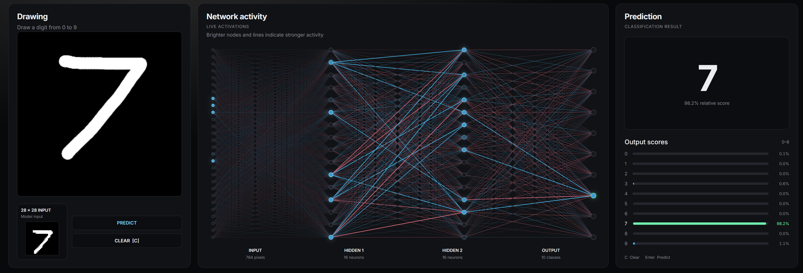
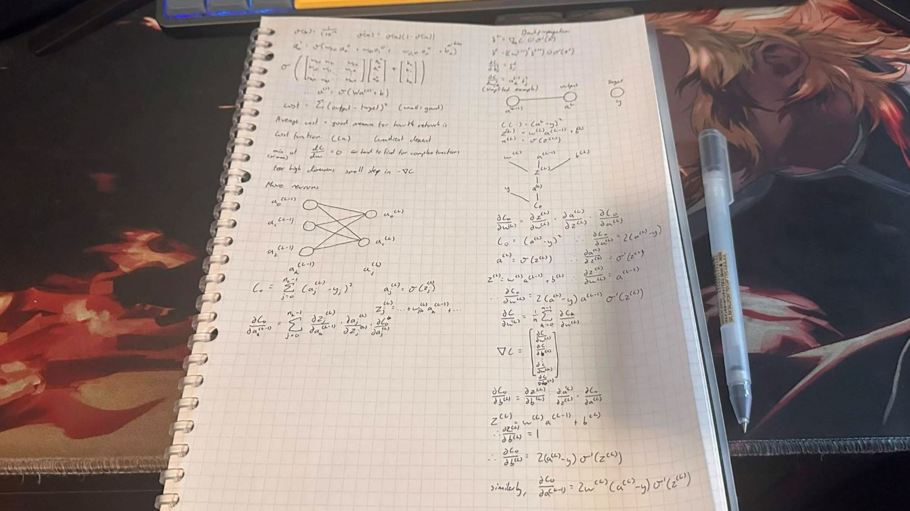
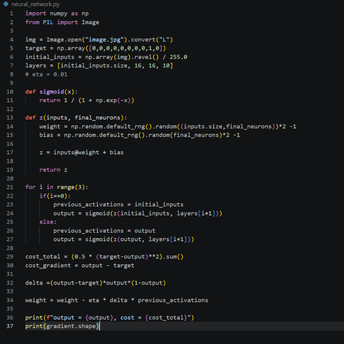

<h1 align="center">Neural Network</h1>

<p align="center">
  A from-scratch neural network trained to recognise handwritten digits.
</p>

<p align="center">
  <a href="https://arwinplayz.github.io/Neural-Network/">
    
  </a>
</p>

## Why I built this

I recently hopped on a call with my cousin at university, who had just written a paper on LLMs and neural networks. Naturally, I was intrigued, but I had no clue what he was talking about. So I decided to hop on YouTube and do a quick search, where I came across [3Blue1Brown's neural network series](https://www.3blue1brown.com/topics/neural-networks).

I gravitated towards it because the visual explanations made the mathematics much easier to follow, but I wanted to go beyond watching someone else explain it.

I wanted to understand what was happening inside the network: how an image becomes a collection of numbers, how those numbers move through layers of neurons, how weights and biases affect the result, and how a network learns from its mistakes.

So I decided to build one myself, starting with the classic handwritten-digit classifier trained on MNIST, and then create a visualiser that lets me experiment with it.

The goal wasn't just to get a model that recognises digits. It was to make the underlying mathematics something I could actually see and explore.

## What it does

- **Handwritten digit recognition** — draw a digit and see what the network predicts.
- **Network visualisation** — explore the input layer, hidden layers and output layer.
- **Activation visualisation** — see how the network's neurons respond to an input.
- **Prediction breakdown** — compare the output scores for digits 0–9.
- **Browser demo** — interact with the network through an HTML, CSS and JavaScript interface.
- **From-scratch implementation** — implement the neural network's forward pass and training calculations using NumPy, rather than relying on a high-level neural network framework.

## Screenshots

### The visualiser

<p align="center">
  
</p>

### Learning process

I also wanted to document the mathematics and the process of figuring things out, not just the finished code.

<p align="center">
  
</p>

<p align="center">
  
</p>

## How the network works

The model is a fully connected feedforward neural network trained to classify handwritten digits from the MNIST dataset.

Its architecture is:

$$
784 \rightarrow 16 \rightarrow 16 \rightarrow 10
$$

- **784 input values:** one for each pixel in a $28 \times 28$ grayscale image.
- **16 neurons in the first hidden layer.**
- **16 neurons in the second hidden layer.**
- **10 output neurons:** one for each digit from 0 to 9.

Each layer takes the previous layer's activations, applies weights and biases, and passes the result through an activation function.

### 1. From an image to numbers

A $28 \times 28$ image contains 784 pixels. Each pixel is converted into a numerical intensity, giving the network a vector:

$$
\mathbf{x} \in \mathbb{R}^{784}
$$

The network doesn't directly understand a handwritten digit as an image. It receives these pixel values and learns patterns in them.

### 2. Weights, biases and activations

For a neuron, the weighted input is

$$
z = \sum_i w_i a_i + b
$$

where:

- $a_i$ is an input activation from the previous layer.
- $w_i$ is its associated weight.
- $b$ is the neuron's bias.

The neuron then applies the sigmoid activation function:

$$
\sigma(z) = \frac{1}{1 + e^{-z}}
$$

This maps the weighted input to a value between 0 and 1.

In vector form, a whole layer can be calculated as

$$
\mathbf{a}^{(l)} = \sigma\left(\mathbf{a}^{(l-1)} W^{(l)} + \mathbf{b}^{(l)}\right)
$$

The network repeats this process through its layers until it produces ten output values.

### 3. Making a prediction

Each output neuron corresponds to a digit from 0 to 9. The model selects the digit associated with the largest output value.

Because this network uses sigmoid activations rather than a calibrated probability output, the scores should be interpreted as relative model outputs, not guaranteed probabilities.

### 4. Learning through backpropagation

At the beginning of training, the weights and biases don't encode useful digit-recognition patterns.

The network learns by comparing its predictions with the correct labels, calculating a loss, and adjusting its parameters to reduce that loss.

For a single output, a squared-error term can be written as

$$
C = \frac{1}{2}(a-y)^2
$$

where $a$ is the predicted output and $y$ is the target.

Backpropagation uses the chain rule to calculate how the loss changes with respect to each weight and bias. Gradient descent then updates the parameters:

$$
w \leftarrow w - \eta \frac{\partial C}{\partial w}
$$

$$
b \leftarrow b - \eta \frac{\partial C}{\partial b}
$$

Here, $\eta$ is the learning rate, which controls the size of each update.

Repeating this process over many training examples gradually adjusts the network to recognise patterns associated with each digit.

## Model details

| Property                | Value                                |
| ----------------------- | ------------------------------------ |
| Dataset                 | MNIST handwritten digits             |
| Architecture            | 784 → 16 → 16 → 10                   |
| Hidden-layer activation | Sigmoid                              |
| Output activation       | Sigmoid                              |
| Training approach       | Backpropagation and gradient descent |
| Python implementation   | NumPy                                |
| Visualisation           | Pygame                               |
| Browser interface       | HTML, CSS and JavaScript             |

The Python model achieved approximately **95% test accuracy** in my experiments. Results can vary depending on training settings and preprocessing.

## Technologies

- **Python** — model implementation and training.
- **NumPy** — numerical calculations, weights, biases and gradients.
- **Pygame** — interactive desktop visualiser.
- **HTML, CSS and JavaScript** — browser-based visualiser.
- **MNIST** — handwritten-digit dataset.

## Running the project

### Python visualiser

1. Install Python 3.11 or a compatible version.
2. Install the dependencies:

   ```bash
   pip install -r requirements.txt
   ```

3. Make sure the trained `model.npz` file is available in the expected location.
4. Run the visualiser:

   ```bash
   python visualiser.py
   ```

### Browser demo

If you are running the browser demo locally, follow the instructions in the browser-demo section of the project files to export the trained model weights and start a local web server.

## What I learned

This project helped me connect the mathematics of neural networks with an actual working implementation.

Instead of treating a neural network as a black box, I worked through how inputs, weights, biases, activations, loss and gradients fit together. Building the visualiser also gave me a way to experiment with these ideas and observe the model's behaviour directly.

The most valuable part of the project was understanding _why_ the network produces a prediction, rather than just seeing whether the prediction is correct.

## Inspiration and further reading

A major inspiration for this project was [3Blue1Brown's neural network series](https://www.3blue1brown.com/topics/neural-networks), particularly its visual explanations of neural networks, gradient descent and backpropagation.

The script to train the model is my own work but AI was occaionally used on the visuliser to help me integrate the model.

---

_Built as a hands-on exploration of neural networks, linear algebra and calculus._
